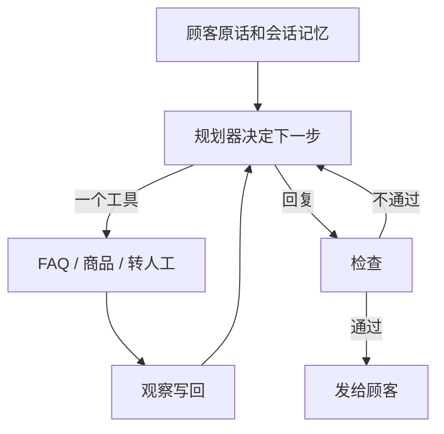

# 澄光肌研客服 Agent

演示店「澄光肌研」的客服。顾客每说一句，规划器决定下一步：查 FAQ、查商品、转人工，还是回复。工具结果写回之后再决定要不要继续。检查不通过，就把意见交回规划器，而不是按人事先画好的流程图往下走。

没有 `DEEPSEEK_API_KEY` 时，同一条循环改由离线策略一步一步决定，15 条金标和 5 条护栏探针仍可复现。有密钥时，产品路径的决策者是 DeepSeek，不是离线策略。

## 六条验收

用户定义：工作流是人把路铺好，系统按图走；Agent 是模型自己决定下一步、调哪个工具、要不要继续循环。

| # | 准则 | 如何满足 | 证据 |
| --- | --- | --- | --- |
| 1 | LLM 做决策，不只是固定流程 | `AgentLoop` 不选择工具名。`LLMPlanner.decide` 只解析模型返回的 `tool_calls`。同一句「满多少包邮」，一份脚本先查 FAQ，另一份直接回复，循环照做。无密钥时的离线策略只为评测复现，不充当产品决策者。 | `chenguang_agent/loop.py`，`chenguang_agent/planner.py` 的 `LLMPlanner`，`tests/test_agent_loop.py` 的 `test_model_choice_not_fixed_route` |
| 2 | 工具调用 | 三个工具读 CSV / 写工单文件：`lookup_faq`、`lookup_product`、`escalate_to_human`。模型按 OpenAI tools 协议调用。 | `chenguang_agent/tools.py`，`chenguang_agent/llm.py` 的 `tool_specs`，`tests/test_tool_contracts.py`，`test_deepseek_http_client_sends_flash_and_tools` |
| 3 | 思考 → 行动 → 观察 → 再思考 | 每一轮先记下思考，执行一个工具，把观察写进对话，再向规划器要下一步。 | `AgentLoop.run` / `_act`，`test_think_act_observe_think_order` |
| 4 | 自主拆解多步任务 | 每次只执行一个工具。模型如果一次列出多个工具，循环只跑第一个，其余等观察后再判断。下一步参数可以只来自上一步观察：测试里顾客原话没有 `SKU08`，模型从 FAQ 观察里读出它再查商品。 | `LLMPlanner` 只保留第一个 tool call，`loop.py` 的 `_decomposition_note`，`test_decomposes_using_observation`，`test_one_tool_per_think_even_if_model_lists_several` |
| 5 | 记忆 / 会话状态 | 同一 `session_id` 的历史写入 `runs/sessions/*.jsonl`。下一轮读回最近 6 轮（原话、意图、回复摘要、用过的工具、SKU），放进规划器上下文。离线策略对「那款」回指上一轮 SKU。 | `session_store.py` 的 `memory`，`agent.py`，`test_session_memory_reaches_the_model_and_the_offline_followup` |
| 6 | 护栏 | 最大迭代（默认 8）、单轮超时（默认 25 秒）、工具超时（2 秒）、工具失败不抛到 CLI、检查打回、输出词表。模型回复越权则丢弃，改由离线策略按已有观察重写。 | `loop.py`，`guardrails.py`，`tools.py`，`test_guardrail_max_iterations_timeout_and_failure`，`tests/test_acceptance.py` |

上表里 LLM 决策的回归不依赖密钥：`tests/test_agent_loop.py` 用脚本模型，并用本机 HTTP 替身断言请求体的 `model` 是 `deepseek-flash`、带三个工具。打到 `api.deepseek.com` 需要自己导出 `DEEPSEEK_API_KEY`。有密钥时 `ask` / `chat` / `serve` 默认走这条客户端。

## 模型

用户指定的名字是 DeepSeek v4.1Flash1017（DeepSeekv4.1Flash1017）。DeepSeek 文档里，这个快照的 API id 是 **`deepseek-flash`**，展示名 **DeepSeek-V4.1-Flash-1017**。旧 id `deepseek-v4-flash` 和 `deepseek-v4-flash-vision-exp` 会路由到同一模型；`deepseek-chat` 已停用，不能再当默认。

| 变量 | 作用 |
| --- | --- |
| `DEEPSEEK_API_KEY` | 没有就走离线循环。评测不读它 |
| `DEEPSEEK_BASE_URL` | 默认 `https://api.deepseek.com` |
| `DEEPSEEK_MODEL` | 默认 `deepseek-flash` |
| `CHENGUANG_MAX_ITERATIONS` | 默认 8 |
| `CHENGUANG_TURN_TIMEOUT_S` | 默认 25 |

```bash
export DEEPSEEK_API_KEY=sk-...
export DEEPSEEK_MODEL=deepseek-flash
python3 -m chenguang_agent ask 满多少包邮
```

调用是 OpenAI 兼容的 `POST /chat/completions`，`thinking` 关掉，`tool_choice` 为 `auto`。事实以工具结果为准，卖点字段不会放进给模型的观察。

## 运行

Python 3.10+，无第三方依赖。在仓库根目录：

```bash
python3 -m chenguang_agent eval
python3 -m chenguang_agent ask 敏感肌能用洁面吗
python3 -m chenguang_agent ask --offline --json --session demo 你们就是骗子
python3 -m chenguang_agent history --session demo
python3 -m chenguang_agent chat
python3 -m chenguang_agent serve
bash scripts/ci_eval.sh
```

`ask` 默认 `auto`：有密钥用 DeepSeek，没有就用离线策略。`--llm` 强制走模型（没有密钥会记 `no_api_key` 并仍把循环跑完）。`--offline` 强制离线。`eval` 始终离线，避免密钥把金标打成非确定性。

当前金标（离线循环）：

```text
金标通过         15/15
意图准确率       15/15
应转人工召回     6/6
误转人工         0/9
护栏探针         5/5
```

## 架构



| 模块 | 做什么 |
| --- | --- |
| `loop.py` | 思考、行动、观察、再思考。到迭代上限或超时时停止。不出现工具名分支。 |
| `planner.py` | `LLMPlanner` 问 DeepSeek。`OfflinePlanner` 在看到上一步观察之后再选下一个动作，供无密钥评测。 |
| `llm.py` | DeepSeek 客户端。默认模型 `deepseek-flash`。 |
| `checker.py` | 复核投诉、孕哺、急性不适、功效、物流编造、卖点和内部口吻。不改句子。 |
| `tools.py` | 仅三个工具。 |
| `render.py` | 离线回复只拼允许说出的字段。卖点不进回复。 |
| `session_store.py` | 追加会话，并给下一轮提供记忆。 |

意图标签仍由词表算出，交给检查和金标。它不决定模型调用哪个工具。

## 工具

| 工具 | 输入 | 返回 | 不做什么 |
| --- | --- | --- | --- |
| `lookup_product` | 商品名或 SKU | 名称、价格、库存、注意事项、问答要点 | 不把卖点说成疗效 |
| `lookup_faq` | 顾客原话或模型拆出的子问题 | 最相近的一条标准答，以及是否允许直接答 | 不编造知识库里没有的政策 |
| `escalate_to_human` | 升级原因 | 工单号、队列、固定话术 | 不批准退款金额 |

契约在 `chenguang_agent/schemas.py`。缺字段、超时、异常都返回 `{"ok": false, "error": {...}}`，不把栈抛到 CLI。

## 护栏

词表在 `data/guardrails.md`。

| 规则 | 行为 |
| --- | --- |
| 骗子、举报、工商、12315、律师、曝光、退全款、投诉 | 转人工，不承诺退款 |
| 孕妇、怀孕、哺乳、备孕、孕期 | 不说能用或不能用，不查商品，转人工并提示遵医嘱 |
| 刺痛、红肿、就医、过敏了 | 先说停用、冲洗、就医，再转人工 |
| 美白、祛痘、眼袋等功效词 | 可以答，卖点不能进回复，也不能写成医疗承诺 |
| 到哪了、运单、轨迹 | 没有轨迹工具，不编造单号或在途状态 |
| FAQ 标记「否」 | 改地址、补差价这类转人工 |
| 最大迭代 / 单轮超时 | 停止再要下一步，按已有观察给一版受护栏约束的回复 |
| 模型回复命中输出禁语 | 记 `checker_rejected`，丢弃该稿 |

输出护栏会换掉「保证美白」「孕妇可以用」「同意退全款」「已签收」以及形如运单号的字符串。

## 示例

敏感肌咨询会先查 FAQ。看到 F07 之后才决定再查洁面，回复不带卖点，也不承诺不过敏：

```text
$ python3 -m chenguang_agent ask --offline 敏感肌能用洁面吗
决策   离线策略
协作
  1. agent · 思考：还没有可用的 FAQ 观察。这一步只查 FAQ，查完再决定要不要查商品或转人工。
  2. agent · 行动：调用 lookup_faq
  3. agent · 观察：lookup_faq 命中 F07（允许直接答）
  4. agent · 思考：看到 FAQ F07 之后，原话或会话里还有未核对的商品，下一步只查目录。
  5. agent · 行动：调用 lookup_product
  6. agent · 观察：lookup_product 命中 SKU01
  7. agent · 思考：这一步的观察够用来回复了。已经看到 F07。
  8. 检查 · 通过
回复
部分单品标注温和方向，但敏感肌个体差异大。建议先看成分表，小面积测肤；不适请停用。我不能向您保证一定不过敏。澄光氨基酸洁面乳（SKU01，120g，69元，现货）。注意事项：避开眼睛；破损皮肤停用；过敏者先测腕内侧。
```

孕哺咨询即使同时提到烟酰胺，看到 F08 不允许直接答之后转人工，不查商品：

```text
$ python3 -m chenguang_agent ask --offline 孕妇能用烟酰胺吗
决策   离线策略
工具   lookup_faq → F08；escalate_to_human → CG-0001
回复
孕哺期请遵医嘱。我不给出能用或不能用的绝对建议，请转人工或咨询医生。这件事需要人工客服按订单规则处理，我马上为您转接。请您准备好订单号，并简单说明情况。
```

「满多少包邮」查完 F03 就回复，不再查商品。

## 评测

`data/eval_cases.csv` 是 15 条金标。`eval` 固定 `planner="offline"`，环境里即使有 `DEEPSEEK_API_KEY` 也不会打到模型。

另外 5 条探针不计入 15 分，失败一样会让命令退出非 0：物流不编造、输出护栏、备孕走 F08、转人工话术不重复、卖点不当成疗效。

```bash
bash scripts/ci_eval.sh
```

脚本先跑评测，再跑 `tests/`。GitHub Actions 在 `.github/workflows/eval.yml`。

带模型的决策路径在 `tests/test_agent_loop.py`，不需要 API 密钥。

## 会话

`ask --session demo` 把每一轮追加到 `runs/sessions/demo.jsonl`。同一 `turn_id` 不会覆盖。下一轮开始时，规划器能看见先前的原话、回复摘要和 SKU。所以「敏感肌能用洁面吗」之后再说「那款多少钱」，离线策略会去查 SKU01，而不是当成闲聊。

```bash
python3 -m chenguang_agent history --session demo
```

`runs/` 已在 `.gitignore`。换目录用 `CHENGUANG_RUNS_DIR`。

## 可观测性

文本输出带意图、知识库指纹、升级原因、决策者（`deepseek-flash` 或离线策略）、打回次数，以及每个工具的 `latency_ms`。`--json` 里还有 `planner`、`trace`、`send_backs`。

`ask`、`chat`、`serve` 每轮追加一行到 `runs/observability.jsonl`。评测默认不写这行。

## 安全与滥用

默认拒绝超过 1000 字的原话（`CHENGUANG_MAX_INPUT_CHARS`），不检索、不调用工具。同一会话每分钟默认 30 次（`CHENGUANG_RATE_LIMIT`），计数在进程内存里。不带 `session_id` 的单次 `ask` 不进桶，所以评测不受限。

这些都不是生产控制。关键词会误伤。限流换个进程就绕过。

## 人工升级

`escalate_to_human` 从 `runs/ticket_seq.txt` 取递增编号，形如 `CG-0001`。工单写在 `runs/tickets.jsonl`，含原因、时间、原话摘要、会话和 `status: open`。演示级认领没有接口，人工改文件即可。

## 知识库

| 文件 | 内容 |
| --- | --- |
| `data/store.md` | 店名、发货、退换、必须转人工 |
| `data/products.csv` | SKU01–SKU10 |
| `data/faq.csv` | F01–F20 |
| `data/guardrails.md` | 固定话术和词表 |
| `data/eval_cases.csv` | T01–T15 |
| `data/retrieval_terms.txt` | 问句检索词 |
| `data/faq_aliases.json` | 口语补充 |
| `data/VERSION` | 当前 `2026-10-12.1` |

`kb_version` 是版本号加语料 SHA256 前 12 位。改 CSV 或词表时把 `data/VERSION` 第一行改成新的日期序号，再跑评测。

## 部署

```bash
python3 -m chenguang_agent serve --host 127.0.0.1 --port 8765
```

`GET /health` 返回 `{"ok": true, "kb_version": "..."}`。`POST /ask` 的正文是 `{"question": "满多少包邮", "session_id": "可选"}`。超长返回 413，会话超限返回 429。有密钥时这个进程默认用 DeepSeek 决定下一步；`--offline` 可关掉。

这还不是线上接入。缺鉴权、多租户、HTTPS、真实订单和物流。

## 边界

这是演示，不是生产客服。离线策略盖不住长尾说法。没有订单系统，改地址和差价只能升级。转人工不会进真实队列。15 条金标用来锁护栏，不能当成线上大盘。DeepSeek 的实网回复会随模型变化，所以金标不走实网；实网路径用 `tests/test_agent_loop.py` 锁住「模型说什么，循环就做什么」。

案例叙述见 [PORTFOLIO.md](PORTFOLIO.md)。
